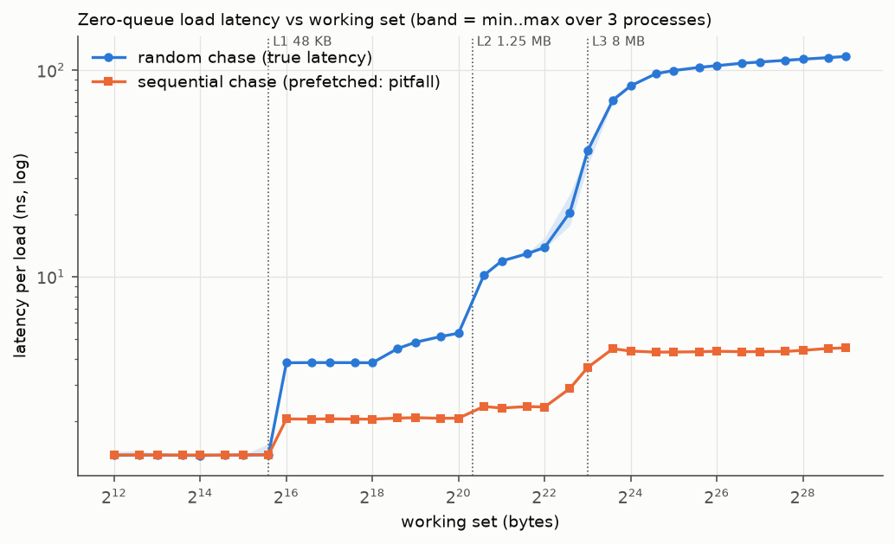
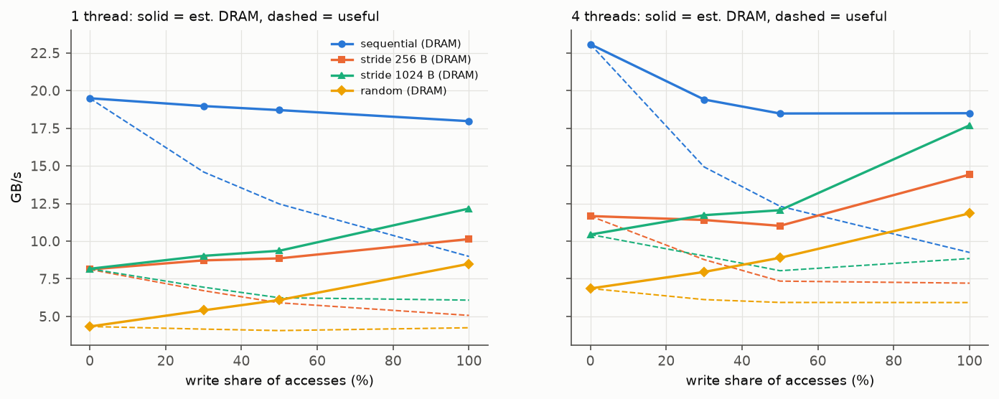
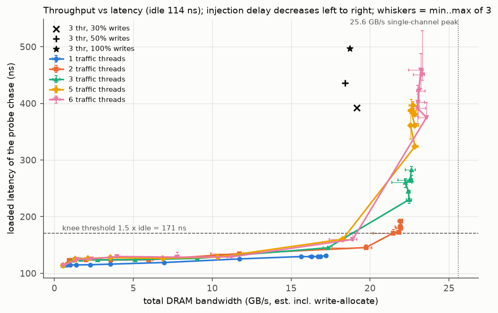
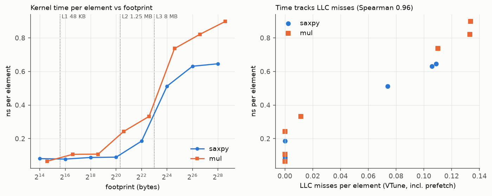
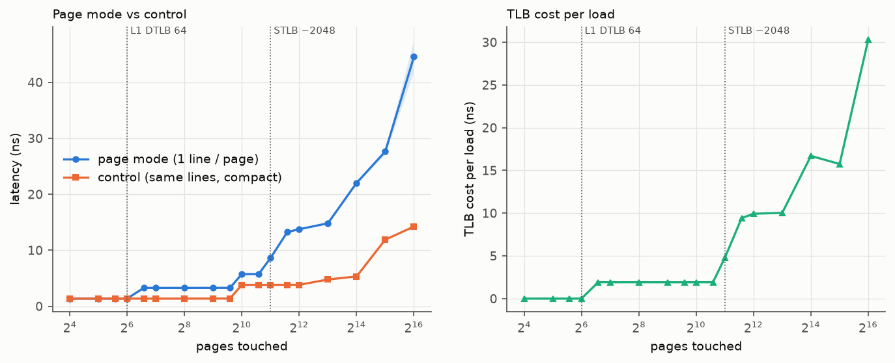
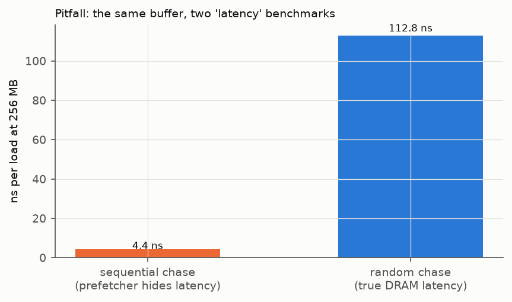

# Project #2: Cache & Memory Performance Profiling, Report

ECSE 4320/6320 Advanced Computer Systems. Intel Core i3-1125G4 (Tiger Lake)
laptop, Windows 11, single-channel DDR4-3200.

Pre-registered predictions: [HYPOTHESES.md](HYPOTHESES.md), committed before
any benchmark existed; [HYPOTHESES_REVIEW.md](HYPOTHESES_REVIEW.md) holds the
corrections made before any sweep. Procedures: [METHODS.md](METHODS.md).
Every number below comes from [RESULTS_TABLES.md](RESULTS_TABLES.md)
(generated by `scripts/analyze.py`). The full record of decisions, bugs and
fixes is in [NOTES.md](NOTES.md), and the student's review contributions are
in [CONTRIBUTIONS.md](CONTRIBUTIONS.md). AI-use note: [AI-USE.md](AI-USE.md).

**Headline.**
- Idle latency: L1 5.0, L2 14.1, L3 ~40 (pure) / 51 cycles (with TLB), DRAM
  82.5 ns pure, 105-116 ns with 4 KB-page TLB cost.
- Bandwidth: one core streams 19.5 GB/s, four cores 23.1 GB/s, against a
  25.6 GB/s single-channel peak.
- Knee: latency stays flat until ~72-84% of peak bandwidth, then rises 2.5-4x
  while bandwidth barely grows.
- TLB steps appear exactly at the DTLB (64 pages) and STLB (~2048 pages)
  reach, and counters confirm they are TLB walks.
- A sequential pointer chase under-reports DRAM latency 26x, and background
  activity biased an entire sweep. Both are documented as pitfalls.

## 1. System configuration and rigor (rubric: 25)

| Item | Value |
|---|---|
| CPU | Intel Core i3-1125G4, 4 cores / 8 threads (SMT on), L1D 48 KB, L2 1.25 MB per core, L3 8 MB shared |
| Memory | one 8 GB DDR4-3200 SODIMM in a 2-slot board: **single channel**, 25.6 GB/s theoretical (inventory + measured bandwidth); no NUMA |
| OS / tools | Windows 11 Home 26200; gcc 16.2.0 (MSYS2 UCRT64) `-O2 -g -march=x86-64-v3`; Intel VTune 2026.6 (counters; Linux `perf` unavailable) |
| Frequency policy | Balanced scheme, "Best performance" slider, AC power, turbo on; core clock measured before/after every run (median 3.68 GHz) |
| Pages | 4 KB. 2 MB large pages need SeLockMemoryPrivilege, which was not granted, so the huge-page comparison was not run |
| Pinning | single-thread tools pinned to logical CPU 2 (core 1); traffic threads one per other core (core 0 last), SMT siblings only when asked; the probe core's sibling is kept free |
| Repetitions | 3 full repetitions, each a separate process; repetition loop outermost; min over trials within a process, median and min..max across processes |
| Interference control | `typeperf` per-CPU log during sweeps; rows with another CPU > 25% busy are flagged (rule fixed in advance); see section 6 |
| Correctness | `scripts/test.sh`, 366 checks: single-cycle pointer chains, cache-set balance, bandwidth coverage/checksums, mutants that must fail, asm checks, sanity vs known values |
| Reproduce | README: `capture_env.sh`, `build.sh`, `test.sh`, `run_sweeps.sh`, `run_counters.sh` (admin), `analyze.py` |

**Tools (Intel MLC equivalent, `src/`).**
- `lat`: dependent pointer chase over a single random cycle (Sattolo's
  algorithm); modes random / seq / page; K independent chains.
- `bw`: sequential / strided / random line order x 8-64 B per line x
  read/write mix x regular or non-temporal stores, 1-8 threads.
- `loaded`: latency probe plus throttled traffic threads.
- `kern`: saxpy / mul kernels for the counter runs.

**Counter validation** (VTune values checked against first principles before use):

| check | measured | expected |
|---|---|---|
| saxpy instructions / element (loop = 6 instr per 8 floats) | 0.7524 | 0.75 |
| saxpy L2 lines in / element | 0.1259 | 2 x 4 B / 64 = 0.125 |
| mul L2 lines in / element (z write-allocated) | 0.1898 | 3 x 4 B / 64 = 0.1875 |
| chase loads = instructions / 2.5 vs L1 hits (16 KB) | 1.594e9 | 1.594e9 |
| DRAM GB/s at 100% writes: our model vs VTune | 15.6 | 15.3 (VTune average) |

## 2. Zero-queue latency baselines (rubric: 25)

| level | working set | ns | cycles (3.68 GHz) |
|---|---|---|---|
| L1 | 16 KB | 1.36 | 5.0 |
| L2 | 128 KB | 3.83 | 14.1 |
| L3 | 4 MB | 13.82 | 50.8 |
| DRAM | 64 MB | 104.9 | 386 |
| DRAM | 256 MB | 112.8 | 415 |
| DRAM | 512 MB | 116.3 | 428 |

- **Method.** Every load's address comes from the previous load, over one
  random cycle covering every line, so loads cannot overlap and prefetchers
  cannot predict them. The value per process is the minimum over trials. The
  spread over 3 processes is <= 2% except at the two smallest sizes (4-6%)
  and near cache boundaries: 13% at 48 KB, and 6-37% at 4-12 MB, where L3
  sharing makes the result placement-dependent.
- **Caveats.** Above 256 KB (the DTLB reach) each figure includes TLB cost.
  The AMAT fit (section 5) separates it: **pure L3 = 11.0 ns (~40 cycles),
  pure DRAM = 82.5 ns**, and 4 KB-page translation adds up to 30 ns at
  256 MB. Hardware prefetchers cannot be disabled on Windows, which is why
  the random pattern is used.
- **Run-to-run variation.** DRAM-latency medians drift 10-25% between runs on
  this laptop, while minima stay stable to ~1%. Each process also gets
  different physical pages (112-137 ns idle seen across processes).
- **Transitions** fall where expected: L1 -> L2 between 48 and 64 KB; L2 -> L3
  just past 1.25 MB; L3 -> DRAM gradual from ~4 MB (shared L3).

## 3. Pattern, granularity and read/write sweeps (rubric: 35)

DRAM-resident (256 MB), 64 B per line. Useful = bytes the program touched;
est. DRAM = lines x 64 B x (1 + write share) for regular stores, which pay a
read-for-ownership plus a write-back. VTune measured that model within 2%.

| pattern (1 thread) | read GB/s | 30% writes: useful / DRAM | 50%: useful / DRAM | 100%: useful / DRAM |
|---|---|---|---|---|
| sequential | 19.49 | 14.59 / 18.97 | 12.47 / 18.70 | 8.98 / 17.97 |
| stride 256 B | 8.12 | 6.71 / 8.72 | 5.90 / 8.86 | 5.07 / 10.14 |
| stride 1024 B | 8.16 | 6.94 / 9.02 | 6.24 / 9.36 | 6.08 / 12.17 |
| random | 4.33 | 4.16 / 5.40 | 4.06 / 6.09 | 4.25 / 8.49 |

| pattern (4 threads) | read | 30% | 50% | 100% |
|---|---|---|---|---|
| sequential | 23.08 | 14.93 / 19.41 | 12.32 / 18.48 | 9.25 / 18.50 |
| random | 6.86 | 6.12 / 7.95 | 5.93 / 8.89 | 5.92 / 11.84 |

- **Sequential read** reaches 76% (1 thread) and 90% (4 threads) of the
  25.6 GB/s channel. One core nearly saturates a single channel.
- **Writes** cost twice the DRAM traffic per useful byte: 100% regular stores
  give 9.0 GB/s useful = 18.0 GB/s DRAM. **Non-temporal stores** skip the
  read-for-ownership and reach 22.1 GB/s useful.
- **R/W mixes:** total DRAM bandwidth falls as writes are added (read/write
  turnarounds on the bus): 19.5 -> 19.0 -> 18.7 -> 18.0 GB/s for 1 thread.
  Latency suffers most (section 4): 282 ns read-only vs 436 ns (50/50) and
  497 ns (100% writes) at full intensity.
- **Granularity:** 8 B per line gives the same line rate as 64 B (277 vs
  305 M lines/s), so useful bandwidth scales with bytes used. DRAM moves
  whole lines.
- **Stride:** 256 B and 1024 B strides cut the line rate to ~127 M lines/s,
  i.e. 42% of sequential, as prefetching loses effectiveness.
- **Random:** 4.3 GB/s per thread = 67.7 M lines/s. At ~113 ns per miss that
  is only ~7.6 lines in flight (Little's Law), because each random access
  also needs a page walk.

## 4. Throughput-latency knee and Little's Law (rubric: 35)

One thread chases pointers (the latency probe) while 1-6 traffic threads
stream at a controlled injection delay. Idle latency is 113.8 ns. **Knee
(fixed in advance in METHODS.md) = the bandwidth where probe latency first
exceeds 1.5x idle = 171 ns.**

| traffic threads | knee GB/s | % of 25.6 | top GB/s | top latency ns | lines in flight at top |
|---|---|---|---|---|---|
| 1 | not reached (max 17.2 GB/s at 131 ns) | - | 17.20 | 131 | 35 |
| 2 | 21.43 | 83.7 | 21.94 | 192 | 66 |
| 3 | 18.87 | 73.7 | 22.61 | 282 | 100 |
| 5 | 18.56 | 72.5 | 22.71 | 396 | 141 |
| 6 | 19.14 | 74.8 | 23.31 | 451 | 164 |

- **Diminishing returns.** Up to ~12 GB/s latency stays within 114-135 ns,
  and at ~17 GB/s it is 130-145 ns.
  Past the knee, extra traffic threads add almost no bandwidth (22.6 -> 23.3
  GB/s from 3 to 6 threads) while latency climbs 282 -> 451 ns: requests
  only queue longer.
- **Little's Law (N = bandwidth x latency / 64 B)**, single core with K
  independent chains ([plot](../plots/mlp.png)):
  - throughput grows linearly to **K = 12** (5.68 GB/s, 135 ns, 12 lines in
    flight);
  - it is flat at K = 14-16 (5.9 GB/s) while latency rises to 175 ns: an
    effective per-core concurrency limit of ~12.
  - This does not identify the structure: fill buffers and page walkers
    (every random access walks) are both candidates.
- **System-wide,** the top points imply 100-164 lines in flight. That is only
  possible because hardware prefetches from the streaming threads count.
- **Approximation:** R is the probe's latency, not the mean over all
  requests. VTune measured 20.7 GB/s average (23.1 max) at the 3-thread top
  point vs our 22.0 GB/s estimate, so the bandwidth axis is confirmed within
  setup dilution.

## 5. Working set, cache misses and TLB (rubric: 35)

**Cache-miss impact.** saxpy and mul across footprints 16 KB - 400 MB, with
VTune counters per element. Line fills per element match theory within 1.2%
in every DRAM run (0.125 / 0.1875 expected).

| counter (per element) vs ns per element | Pearson r | Spearman rho |
|---|---|---|
| LLC misses incl. prefetch (`LONGEST_LAT_CACHE.MISS`) | 0.978 | 0.956 |
| L2 lines in (`L2_LINES_IN.ALL`) | 0.830 | 0.918 |
| demand L3 misses (`MEM_LOAD_RETIRED.L3_MISS`) | 0.753 | 0.882 |

Counter choice matters. Prefetching hides about half of the DRAM lines from
the demand-miss counter (saxpy at 32M: 0.068 demand misses vs 0.126 lines
per element), so it correlates worst with runtime.

**AMAT.**
- Method: measured per-level hit fractions (VTune) x per-level latencies,
  plus the TLB cost from below. Pure L3 and DRAM latencies are solved from
  two calibration sizes (4 MB, 256 MB).
- Result: every **other** size is predicted within 10% (H5 target 15%).

| size | 64K | 256K | 1M | 2M | 8M | 16M | 64M |
|---|---|---|---|---|---|---|---|
| AMAT error % | -0.5 | 0.0 | +9.8 | -5.2 | +7.3 | -7.3 | -5.5 |

**TLB.** Page mode touches one line per 4 KB page. The control touches the
same number of lines packed into a few pages.

| pages | 64 | 96 | 2048 | 3072 | 8192 | 32768 | 65536 |
|---|---|---|---|---|---|---|---|
| TLB cost ns (page - control) | 0.0 | 1.9 | 4.8 | 9.4 | 10.0 | 15.8 | 30.3 |
| page walks per load (VTune) | 0.00 | 0.00 | 0.19 | 0.85 | 0.94 | 0.97 | - |

- **Past 64 pages (L1 DTLB reach):** +1.9 ns = ~7 cycles per load, with no
  page walks: second-level TLB hits.
- **Past 2048 pages (STLB reach):** +9.4-10 ns = ~35-37 cycles, with ~0.9
  walks per load.
- **Cache conflicts ruled out:** at 3072 pages, page mode and control are
  both ~100% L2 hits; only the walk count differs. (An earlier page layout
  did conflict, using only 64 of 1024 L2 sets. It was caught by counters and
  fixed before any sweep.)
- **Beyond ~16K pages,** page-table entries themselves stop fitting in
  cache, and the cost grows to 30 ns.
- **Huge pages** were not measured (the privilege was not granted). The 32
  DTLB entries for 2 MB pages would move the first step to 64 MB.

## 6. Benchmark pitfalls and AI use (rubric: 15)

1. **Measuring the prefetcher instead of DRAM.**
   - A *sequential* pointer chase over the same 256 MB buffer reports
     **4.4 ns**, against a true 112.8 ns: a **26x under-report**.
   - Counters prove the data really came from DRAM: 1.015 line fills and
     0.89 LLC misses per load.
   - The prefetcher fetches ahead, so the "latency" is the streaming
     rate.
2. **Background activity (a complete sweep run rejected).**
   - Running sweeps while the machine was in use (status checks, app
     rendering, document editing) flagged 30% of rows.
   - Flagged repetitions were biased: median latency **+12.8%** (p90 +46%),
     bandwidth **-11.9%** (bwws) and -3.3% (bw).
   - The run is archived in `data/raw/run1_interfered/`. A quiet re-run plus
     re-measurement of the 26 still-flagged latency rows produced the final
     data.
   - Remaining flags on multi-core rows were shown to have no measurable
     effect (flagged/unflagged 0.995-1.003).
3. **Pinning (negative result).** On a quiet machine, unpinned DRAM latency
   was *not* noisier: CV 0.65% unpinned vs 4.63% pinned, the latter from one
   131.8 ns outlier. Pinning matters under load; on an idle laptop the OS
   rarely migrates the thread.

AI use, and what was independently checked, corrected or rejected:
[AI-USE.md](AI-USE.md).

## 7. Hypotheses scorecard

| | prediction | result | verdict |
|---|---|---|---|
| H1 | L1 5, L2 13-16, L3 40-70 cyc, DRAM 85-110 ns | 5.0 / 14.1 / 40 pure (51 with TLB) / 82.5 ns pure, 105-116 with TLB | holds; DRAM above range only through TLB cost |
| H2 | seq 1T ~20, 4T 22-24 GB/s; writes ~half; random 7-8 GB/s/thread | 19.5 / 23.1; writes 0.46x; random 4.3 | mostly holds; random lower (page walk per access) |
| H3 | knee at 60-75% of peak; ~2-3x idle at saturation; ~31 lines; K plateau 10-12 | 72-84%; 2.5x (3 thr) to 4x (6 thr); 100-164 lines; plateau ~12 | knee slightly later; Little's Law count far higher (prefetches) |
| H4 | runtime tracks LLC misses (r > 0.9); demand misses undercount | r 0.978 with LLC misses; demand counter 0.753, sees ~54% of lines | holds |
| H5 | AMAT within 15% | within 10% out-of-sample | holds |
| H6 | steps at 64 (+~7 cyc) and ~2048 pages (+20-40 cyc) | +7.1 cyc at 96 pages; +35-37 cyc at 3072-8192 | holds; huge pages untested |
| H7 | seq-chase under-reports >= 10x; unpinned noisier | 26x; unpinned NOT noisier | first holds, second does not |

## 8. Limitations

- **Windows, laptop.** No `perf`; no core isolation; turbo and uncore clocks
  vary. Each sweep row is a separate process with different physical pages,
  so DRAM latency varies between processes (handled with 3 repetitions and
  minima).
- **Prefetchers stay on** (no MSR access), so "latency" uses random patterns
  only.
- **No huge pages** (SeLockMemoryPrivilege not granted on Windows 11 Home).
- **VTune counter scaling.** At 64-256 MB the `MEM_LOAD_RETIRED` bucket sum
  exceeds the exact load count (instructions / 2.5) by 16-23%. The likely
  cause is multiplexing: 7 programmable events, each scaled separately. It
  is not confirmed. Fractions are therefore taken within the buckets, and
  the ratio is reported (RESULTS_TABLES section 7). Single-phase runs match
  exactly (16 KB).
- **Bandwidth in L1/L2.** `bw`'s general loop caps at ~100 GB/s, so its
  L1/L2 points are lower bounds. L3 (51 GB/s) is verified L3-served and
  matches Project 1's dedicated measurement.
- **Little's Law** uses the probe's latency for all requests; prefetches make
  the in-flight count an upper-level estimate, not a hardware-structure size.
