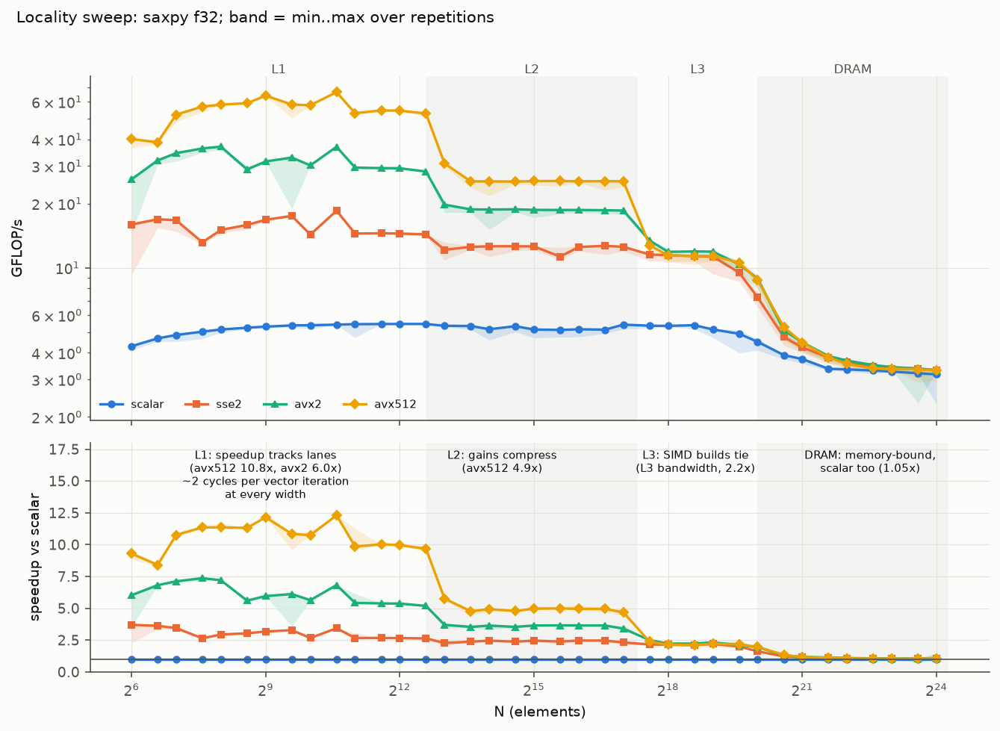
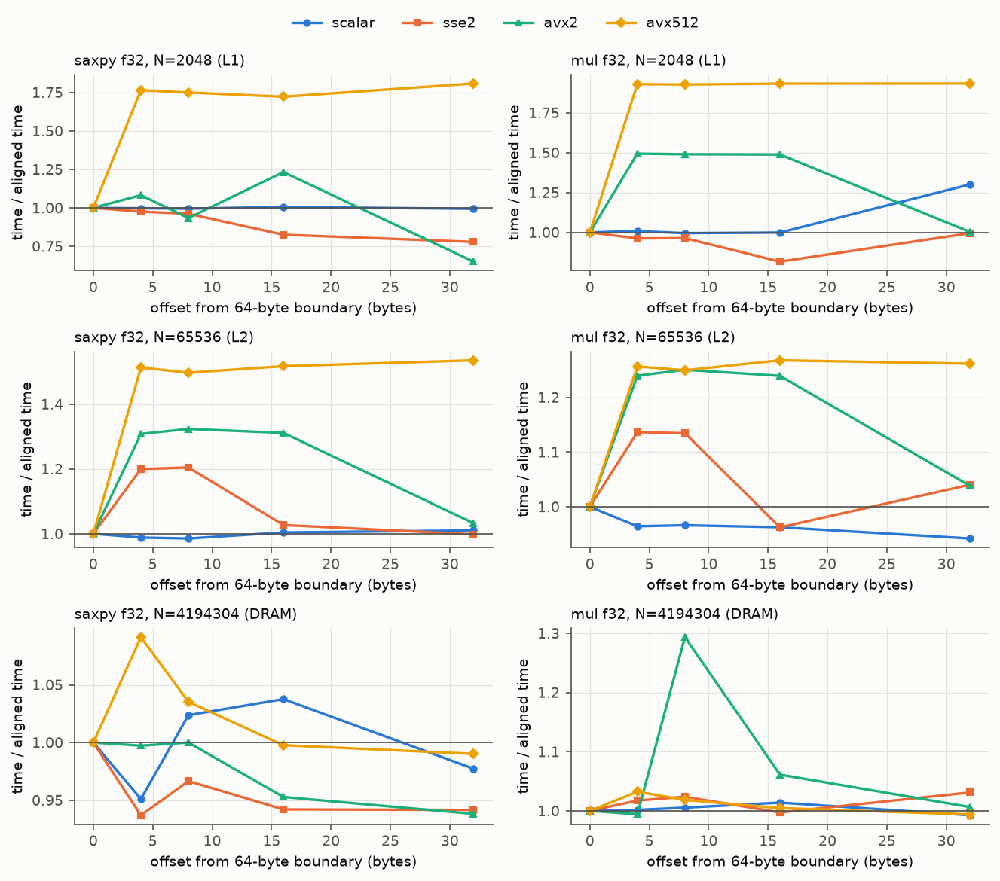
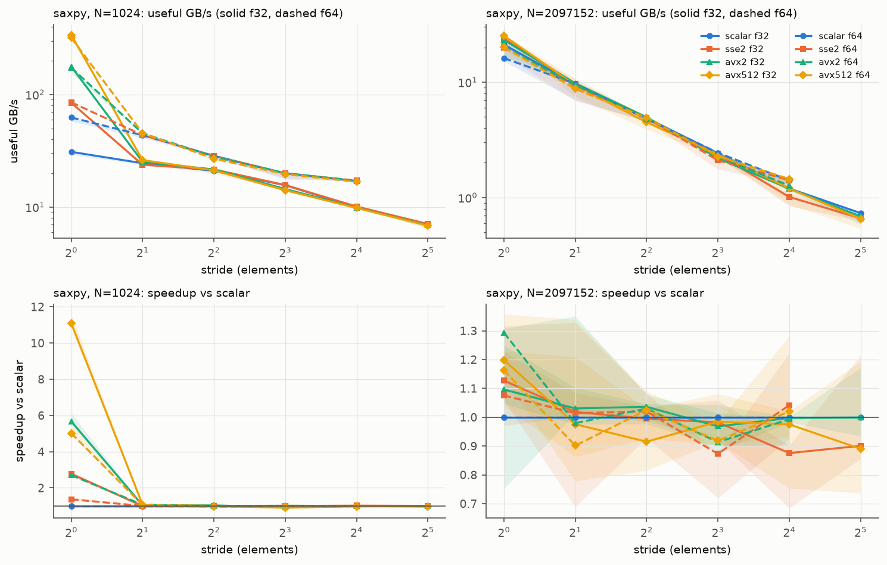
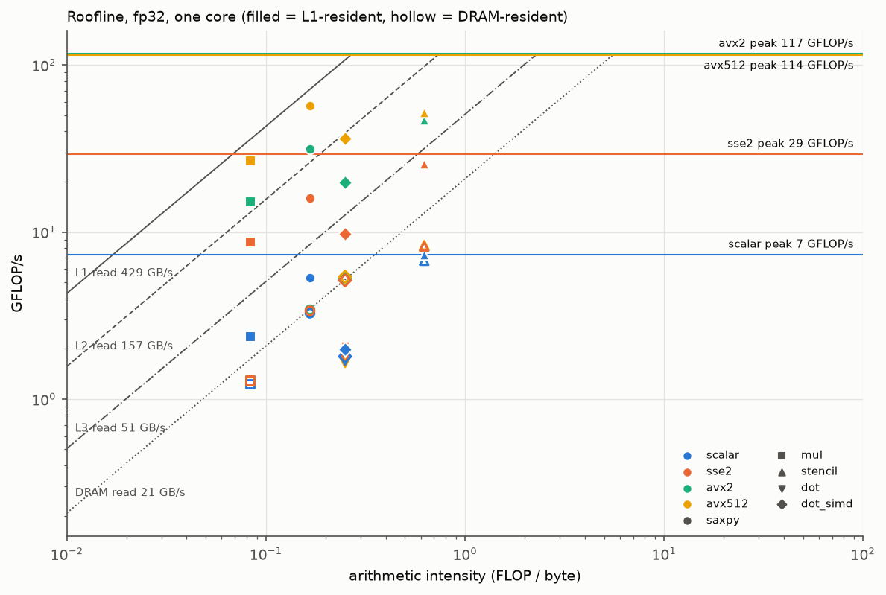

# Project #1: SIMD Advantage Profiling, Report

ECSE 4320/6320 Advanced Computer Systems. Single-core study of scalar vs SSE2,
AVX2 and AVX-512 code for five kernels on an Intel Core i3-1125G4.

The pre-measurement predictions are in [HYPOTHESES.md](HYPOTHESES.md),
committed before any benchmark ran (see git history), and are scored in
section 8. Every number comes from [RESULTS_TABLES.md](RESULTS_TABLES.md)
(generated by `scripts/analyze.py`). The AI-use note is
[AI-USE.md](AI-USE.md).

**Headline.** In L1, SIMD speedup tracks the lane count: saxpy f32 is 3.0x
(sse2), 6.0x (avx2) and 10.75x (avx512) over scalar. The gain compresses
through L2 (4.9x), ties across all SIMD widths in L3 (~2.2x), and vanishes in
DRAM (1.05x), where scalar code alone already saturates the 21 GB/s
single-core bandwidth. AVX-512 doubles AVX2 in L1 although both have the same
measured FMA peak (~115 GFLOP/s), because these kernels are bound by
load/store work per iteration, not by FMA throughput.

## 1. Methodology

| Item | Value |
|---|---|
| CPU / ISA | Intel Core i3-1125G4 (Tiger Lake), 4 cores / 8 threads; SSE4.2, AVX2, FMA, AVX-512F/DQ/BW/VL |
| Caches | L1D 48 KB/core, L2 1.25 MB/core, L3 8 MB shared |
| Memory | 8 GB DDR4-3200, one module (single channel) |
| OS | Windows 11 Home, build 26200 |
| Compiler | gcc 16.2.0 (MSYS2 UCRT64), `-O3 -std=gnu11 -ffp-contract=fast` |
| Frequency policy | Balanced scheme, power slider "Best performance", on AC power; turbo left on. Effective clock measured per run: median 3.68 GHz, 3.2% of rows started below 3.3 GHz |
| SMT | enabled (8 logical CPUs); benchmark pinned to logical CPU 2; sibling not isolated |
| Pinning / priority | `SetThreadAffinityMask`, `HIGH_PRIORITY_CLASS`, `THREAD_PRIORITY_HIGHEST`; single-threaded throughout |
| Timing | `QueryPerformanceCounter` (10 MHz, 100 ns tick). Repetitions per trial grown until a trial lasts >= 20 ms; median of 7 trials per run; 3 full sweep repetitions |
| Cycles | time x frequency, measured by a dependent integer-add chain (1 cycle/add) before and after each run. No hardware counters on Windows |
| Data | deterministic LCG values in [0.5, 1.5): no denormals, no cancellation. 64-byte aligned via `_aligned_malloc`, plus an optional byte offset for the alignment study |
| Validation | every timed run is first checked against a long-double reference, and guard elements after each array must remain unchanged |

**Builds** (`scripts/build.sh`). These map to the rubric's "scalar-only,
default auto-vectorized, CPU-targeted widest":

| build | flags beyond common | vectors |
|---|---|---|
| scalar | `-march=x86-64 -fno-tree-vectorize -fno-tree-slp-vectorize` (no `-fopenmp-simd`) | none |
| sse2 | `-march=x86-64 -fopenmp-simd` (gcc default target) | 128-bit |
| avx2 | `-march=x86-64-v3 -fopenmp-simd` | 256-bit + FMA |
| avx512 | `-march=tigerlake -mprefer-vector-width=512 -fopenmp-simd` | 512-bit + FMA |

All builds add `-Wa,-muse-unaligned-vector-move`. Win64 gcc cannot guarantee
32/64-byte stack alignment for spilled vector registers (GCC PR 54412), so
aligned spill moves could fault. The flag has no cost on aligned data on
this core.

**Kernels** (`src/kernels.c`): saxpy `y=a*x+y`; elementwise multiply
`z=x*y`; 3-point stencil; dot product, both plain and with
`#pragma omp simd reduction`; strided saxpy. Each comes in fp32 and fp64.

**Metrics:** runtime, GFLOP/s, *useful* GB/s (10^9 bytes; write-allocate
traffic not counted), and cycles/element. Variability: plots show min..max
over the 3 repetitions as shaded bands. Median run-to-run CV is 2.5%.

## 2. Baseline and correctness (rubric: 15)

- `scripts/test.sh` runs 1121 checks: every build x kernel x dtype at 18
  sizes (N = 1 .. 1M, including vector-width remainders), misaligned
  offsets, and strides 2-64. All pass (`data/raw/correctness.log`).
  Tolerances: 8 eps for elementwise kernels, and the (n+8) eps worst-case
  summation bound for dot products. Untouched elements must be bit-exact.
- **The checks were themselves tested.** A deliberately broken copy of the
  kernels (off-by-one tail, out-of-bounds write) failed as expected.
- Every one of the 6048 timed sweep rows also passed validation.
- Reproduction: the README lists the five commands from a clean clone to all
  figures.

## 3. Vectorization verification (rubric: 15)

`scripts/verify_vec.py` cross-checks gcc's `-fopt-info-vec` report against
the assembly, for all 48 build x function pairs
([VECTORIZATION.md](VECTORIZATION.md), 0 problems). Hot loops, saxpy f32:

```asm
# scalar: 1 element per iteration, no FMA in the x86-64 baseline
movss (%r8,%rax,4),%xmm0 ; mulss %xmm1,%xmm0 ; addss (%r9,%rax,4),%xmm0 ; movss %xmm0,(%r9,%rax,4)
# avx2: 8 floats per iteration, fused multiply-add
vmovups (%r8,%rax),%ymm0 ; vfmadd213ps (%r9,%rax),%ymm2,%ymm0 ; vmovups %ymm0,(%r9,%rax) ; addq $32,%rax
# avx512: 16 floats per iteration
vmovups (%r8,%rax),%zmm0 ; vfmadd213ps (%r9,%rax),%zmm2,%zmm0 ; vmovups %zmm0,(%r9,%rax) ; addq $64,%rax
```

- **Vector width:** each SIMD build uses its full register width (xmm / ymm
  / zmm) for every unit-stride kernel. Loop steps of 16 / 32 / 64 bytes
  give 4 / 8 / 16 fp32 lanes, half that for fp64.
- **FMA:** avx2 and avx512 contract `a*x+y` into `vfmadd213ps`. The scalar
  and sse2 baselines have no FMA (separate multiply and add).
- **Masking:** the avx512 code uses **no** mask registers (0 `{%kN}`
  operands in `build/asm/kernels_avx512.s`, regenerated by
  `scripts/build.sh`). Remainders are handled by a
  32-byte epilogue loop and then scalar code, not by masked loads/stores.
  The tail study (Section 5) measures exactly this.
- **Reductions:** the plain dot is an *in-order* reduction (packed
  multiply, then a serial chain of `vaddss`). The `omp simd` dot is a true
  packed accumulation: `vfmadd231ps (%r8,%rax),%zmm2,%zmm0`.
- **Pitfall avoided:** gcc vectorizes `omp simd` loops even under
  `-fno-tree-vectorize`. The scalar build therefore omits `-fopenmp-simd`,
  and the scalar assembly is checked to contain no packed FP math.

## 4. Locality and memory-bound analysis (rubric: 20)



| saxpy f32, speedup vs scalar | L1 | L2 | L3 | DRAM |
|---|---|---|---|---|
| sse2 | 3.03 | 2.42 | 2.14 | 1.05 |
| avx2 | 6.02 | 3.64 | 2.23 | 1.05 |
| avx512 | 10.75 | 4.95 | 2.15 | 1.05 |

- **L1.** At every width, one vector iteration costs about 2 cycles (sse2
  2.06, avx2 1.94, avx512 2.04 at N=1024). Speedup therefore scales with
  lanes. The FMA unit is about 25% busy. The limit is the per-iteration
  load/store pipeline (2 loads + 1 store).
- **Transitions** fall where the cache sizes predict (2 arrays x 4 B):
  - L1 between N = 6144 and 8192 (48 KB at 6144);
  - L2 between 131K and 196K (1.25 MB at 160K);
  - a soft L3 edge from 786K to 1.5M (shared 8 MB).
- **Compression.** In L2 the wide builds are capped by L2 bandwidth (avx512
  4.95x). In L3 sse2, avx2 and avx512 converge on 11.3-11.9 GFLOP/s: one
  bandwidth limit for all widths. In DRAM even scalar reaches 3.3 GFLOP/s,
  about 20 GB/s, the measured DRAM roof. Nothing is left for SIMD to
  accelerate.
- All kernels and both dtypes follow this pattern
  (`plots/size_speedup_f32.png`, `_f64`). The stencil keeps 1.3x in DRAM,
  because its scalar version is compute-bound (Section 6).

## 5. Alignment, tail, stride (rubric: 20)



**Alignment.** Every array is shifted by the same byte offset from a 64-byte
boundary.
- avx512 is **1.72-1.93x slower in L1** at any non-zero offset: each 64-byte
  access straddles two cache lines.
- avx2 is 1.49x slower (mul, L1) at 4-16 bytes, but **recovers fully at a
  32-byte offset**, where 32-byte accesses no longer straddle lines.
- The cost shrinks with distance from the core: 1.25-1.54x in L2, and within
  noise (0.94-1.09x) in DRAM.
- sse2 sees only 13-20% (L2), matching the prediction of 10-30%.

**Tail.** `plots/tail.png`, saxpy f32 N = 1..128:
- N=1 costs 9-11 cycles in every build (fixed call/loop overhead).
- Cycles/element then step down in a sawtooth at multiples of the vector
  width: avx2 1.00, then 0.62, at N = 15, then 16; avx512 0.69, then 0.32,
  at N = 31, then 32.
- Remainders run in the unmasked half-width epilogue.
- Steady state by N=128: avx512 0.14, avx2 0.21, scalar 1.52
  cycles/element. avx512 at N=17 still costs 4.3x its N=128 value.



**Stride.**
- **The SIMD gain vanishes at stride 2.** In cache (N=1024), avx512 goes from
  11.1x at stride 1 to 0.90-1.07x for any stride >= 2, in every build and
  dtype. The disassembly explains why: gcc versions the loop on
  `stride == 1`, and every other stride runs a scalar loop (Section 7).
- **Bandwidth in DRAM** (N=2M, f32): useful bandwidth falls from 23.2 GB/s
  at stride 1 to 1.2 GB/s at stride 16, i.e. 19x for 16x fewer useful bytes
  per line. It keeps falling to 0.69 GB/s at stride 32, with no plateau.
  Plausible causes, not tested separately: 128-byte adjacent-line prefetch,
  and TLB reach.
- **Noise.** DRAM strided speedups vary by about +-20% between repetitions
  (bands in the figure), so they are reported as ~1x, not finer.

**Data type** (`plots/dtype_ratio.png`): fp64/f32 element rate is 0.50x in L1
(half the lanes) and 0.47x in DRAM (twice the bytes). The scalar build runs
fp32 and fp64 at the same rate in cache, because one scalar op handles one
element of either width.

## 6. Roofline and quantitative insight (rubric: 20)



Ceilings are measured (`src/peak.c`, `data/raw/peaks.csv`), not taken from
spec sheets:

| | measured | per cycle | note |
|---|---|---|---|
| scalar peak | 7.3 GFLOP/s | 2.0 FLOP | mul and add share ports 0/1 (we had estimated 4) |
| sse2 peak | 29.3 GFLOP/s | 8.0 FLOP | |
| avx2 FMA peak | 116.8 GFLOP/s | 31.7 FLOP | 2 FMA units x 8 lanes x 2 |
| avx512 FMA peak | 114.2 GFLOP/s | 31.0 FLOP | **one** 512-bit FMA unit |
| L1 / L2 / L3 / DRAM read | 429 / 157 / 51 / 21 GB/s | | single core |

Arithmetic intensity, in FLOP per useful byte (fp32): mul 0.083, saxpy
0.167, dot 0.25, stencil 0.625. fp64 halves each.

- **DRAM ridge** is at 117 / 21, about 5.6 FLOP/byte, far right of every
  kernel. **Every kernel is memory-bound in DRAM.** The SIMD points sit on the
  21 GB/s roof once write-allocate is counted:
  - saxpy 20.4 GB/s;
  - mul 15.5 GB/s useful, i.e. 20.6 GB/s with the read-for-ownership of `z`;
  - stencil about 20 GB/s with write-allocate;
  - dot_simd 21.6 GB/s.
- **L1 ridge** is at 117 / 429, about 0.27 FLOP/byte.
  - **saxpy** (left of the ridge, so memory-side): avx512 reaches 57 GFLOP/s =
    342 GB/s, **80% of the L1 roof**.
  - **stencil** (right of the ridge, so compute-side even in L1): it reaches
    52 GFLOP/s, 45% of peak. That is consistent with a limit from its three
    overlapping unaligned loads.
- **Scalar** code is compute-bound in cache. Scalar stencil runs at 100% of
  the scalar peak and scalar saxpy at 72%. That headroom is what SIMD
  converts into speedup, and it disappears once the data comes from DRAM.

## 7. Negative and misleading cases (rubric: AI-use + failure case, 10)

**Plain dot product: SIMD-friendly in appearance, no speedup.**
`plots/dot_negative.png`. Speedup is 0.97-1.08x in every build and every
regime. The loop runs at **4.03-4.06 cycles/element** (sse2, avx2, scalar),
which is the FP-add latency: each `s += x*y` depends on the previous one,
and strict FP order forbids reassociation.

The compiler report is *misleading* here: gcc says "loop vectorized". It
only packs the multiplies and keeps a serial `vaddss` chain:

```asm
vmovups (%r8,%rax),%ymm1 ; vmulps (%rdx,%rax),%ymm1,%ymm1     # 8 products at once ...
vaddss %xmm1,%xmm0,%xmm0 ; vshufps $85,%xmm1,%xmm1,%xmm3 ; vaddss %xmm3,%xmm0,%xmm0 ; ...  # ... summed one by one
```

`#pragma omp simd reduction(+:s)` permits reassociation and gives 9.1x
(avx2) and 18.1x (avx512) in L1. It keeps about 3x even in DRAM, because the
scalar baseline (~7 GB/s) is latency-bound, not bandwidth-bound. Our
hypothesis expected little DRAM gain. That was wrong, and the reason is
instructive.

**Strided saxpy: "vectorized" per the report, scalar in execution.** gcc
guards the vector loop with `cmpq $1, %rdx; jne` (stride == 1), so every
stride > 1 runs a scalar loop. That is why the speedup is ~1x at any stride.
Only the disassembly reveals it.

**What a naive benchmark would get wrong here:**
- comparing against a "scalar" build that still vectorizes `omp simd` loops;
- trusting "loop vectorized" messages (both cases above);
- an L1 bandwidth test with one add per load. Our first version measured
  207 GB/s, below what saxpy itself achieves, because it was capped by the
  single 512-bit ALU port. The fixed version measures 429 GB/s.

### Catalog: every case in this project where the optimization did not help or a naive setup would mislead

The featured cases above are the plain dot product and strided saxpy. The
table lists every such case found during the project, with its evidence.
"Caught by" means sweep data, the assistant's own testing and review
(AI-USE.md), or the student's review.

**A. The expected optimization did not help**

| # | Expected | Measured | Why | Evidence |
|---|---|---|---|---|
| A1 | SIMD speeds up the plain dot product | 0.97-1.08x in every build and regime; 4.03-4.06 cycles/element | strict FP order keeps a serial FP-add chain (4-cycle latency) | Section 7, `plots/dot_negative.png` |
| A2 | SIMD speeds up strided saxpy | 0.90-1.07x at any stride >= 2 (11.1x at stride 1) | gcc vectorizes only the `stride == 1` path; other strides run scalar | Sections 5 and 7, `plots/stride.png` |
| A3 | Wider vectors keep helping in DRAM | saxpy f32 1.05x for sse2, avx2 and avx512 alike | scalar code already reaches the ~20 GB/s DRAM roof | Section 4, `plots/locality_saxpy_f32.png` |
| A4 | AVX-512 beats AVX2 in L3 | avx512 2.15x vs avx2 2.23x (saxpy f32 L3) | one L3 bandwidth limit for all widths | Section 4 |
| A5 | AVX-512 doubles the FMA peak | 114.2 vs 116.8 GFLOP/s | this core has one 512-bit FMA unit | Section 6, `data/raw/peaks.csv` |
| A6 | Wider vectors are always at least as fast | avx512 1.72-1.93x *slower* than aligned at any non-64 B offset (L1) | every 64-byte access splits two cache lines | Section 5, `plots/align_f32.png` |
| A7 | AVX-512 handles tails with masks | 0 mask-register operands; at N=17, avx512 still costs 4.3x its N=128 per-element cost | gcc emits a 32-byte epilogue plus scalar code instead | Sections 3 and 5, `plots/tail.png` |
| A8 | Scalar code reaches 4 FLOP/cycle (spec-style estimate) | 2.0 FLOP/cycle measured | multiply and add share ports 0/1 | Section 6 |

**B. A naive or AI-generated setup or claim would have misled**

| # | Naive setup / claim | What it would have reported | Caught by, and fix | Evidence |
|---|---|---|---|---|
| B1 | "Scalar" build with `-fno-tree-vectorize` but `-fopenmp-simd` | a vectorized baseline, so understated speedups | testing: gcc still vectorizes `omp simd` loops; flag removed, asm check added to `test.sh` | Section 3, AI-USE item 2 |
| B2 | Trusting gcc's "loop vectorized" report | SIMD gains that do not exist (A1, A2) | review of the loop that actually runs | Section 7, `reports/VECTORIZATION.md` |
| B3 | L1 bandwidth test with one add per load | 207 GB/s, below what saxpy itself achieved (401 GB/s) | testing: capped by the single 512-bit ALU port; rewritten (one FMA per two loads), 429 GB/s | Section 7, AI-USE item 5 |
| B4 | AI analysis: "gcc emulates strided access with scalar loads plus inserts" | a wrong mechanism for A2 | review: the stride guard was found; corrected in the report and VECTORIZATION | AI-USE item 8 |
| B5 | AI analysis draft: "AVX-512 is never slower than AVX2" (and three other errors) | false claims (plain dot: 4.46 vs 4.06 cycles/element) | cross-checking each cited number against `data/processed/` | AI-USE item 7 |
| B6 | Correctness tolerance only at large N | a missing tail element in a 1M-element dot passes (inside the (n+8) eps bound) | mutation tests; tails tested at small N | AI-USE item 1 |
| B7 | Windows text-mode output | CRLF line endings inside the raw CSV data | testing; binary stdout before the full sweeps | AI-USE item 4 |
| B8 | One repetition per point | a re-run gave 1.90x (L2 misalignment) and 23.4 GFLOP/s (stencil L3) | 5-repetition re-measure: 1.48x and 28.1 GFLOP/s, matching the committed medians | Section 9, `data/raw/recheck_2026-10-22/` |
| B9 | Cycles from a clock measured with scalar code | hides any AVX-512 frequency drop during the timed loop | stated as a limitation (little sign of one: 8 of 185 sizes) | Section 9 |

## 8. Hypotheses scorecard (from [HYPOTHESES.md](HYPOTHESES.md))

| | Prediction | Result | Verdict |
|---|---|---|---|
| H1 | avx2 4-8x, sse2 2-4x vs scalar in L1 (saxpy f32) | avx2 **6.0x**, sse2 **3.0x** | holds |
| H2 | speedup falls to 1.1-1.6x in DRAM | **1.05x** (saxpy, mul f32) | direction holds; collapse is more complete than predicted |
| H3 | drops near N = 6K (L1), 160K (L2), ~1M (L3) | between 6144 and 8192; between 131K and 196K; gradual 786K-1.5M | holds |
| H4 | fp64 = half the fp32 element rate | **0.50x** in L1, **0.47x** in DRAM (saxpy avx2) | holds |
| H5 | misalignment 10-30% in L1/L2; tails only for N < ~100 | tails hold; misalignment up to **1.93x** (avx512, L1) | tails hold; alignment cost much larger than predicted |
| H6 | stride kills the SIMD gain; bandwidth flattens past one line | speedup ~1.0x for every stride >= 2; bandwidth keeps falling past stride 16 | first half holds; flattening not observed |
| H7 | avx512 at most 1.2x over avx2 in L1, none in DRAM | **1.79x** in L1, 1.00x in DRAM | **falsified** in L1, holds in DRAM |
| H8 | plain dot does not vectorize, about 1x; omp simd dot memory-bound in DRAM | plain dot is *partly* vectorized but still 0.97-1.08x; omp simd dot **2.9x** even in DRAM | performance claim holds; mechanism and DRAM claim wrong |
| H9 | all kernels memory-bound in DRAM | every SIMD kernel sits at the DRAM roof (once write-allocate is counted) | holds |

## 9. Limitations and anomalies

- **Re-run check** (later session, fresh clone, 1 repetition;
  `data/raw/recheck_2026-10-22/`): 96-98% of the 320 regime values
  reproduced within 10% (median ratio 1.00). Both large shifts turned out
  to be single-repetition outliers. A targeted re-measure (5 repetitions)
  gave:
  - stencil f32 in L3: 28.1-28.6 GFLOP/s (avx2 / avx512), matching the
    committed 28.2-28.3 (the re-run's 23.4 was low);
  - avx512 L2 misalignment (saxpy f32, N=65536): median 1.48-1.49x,
    matching the committed 1.54x (the re-run's 1.90x was high).
  Individual repetitions range 1.03-1.51x, so the L2 alignment cost is
  bimodal from run to run. The median is stable.
- **No hardware counters** (Windows; perf unavailable). Cycles are derived
  from time and a measured clock, so any AVX-512 frequency licence during the
  timed loop is invisible. There is little sign of one: avx512 is >5% slower
  than avx2 at 8 of 185 fp32 sizes. The exception is the plain dot product
  (4.46 vs 4.06 cycles/element).
- **Laptop turbo and thermals:** clock 2.81-3.69 GHz. This is mitigated by
  interleaving builds within each point and computing speedups within each
  repetition. Higher variance is concentrated in DRAM and at cache
  transitions.
- **SMT sibling not isolated;** background OS activity is possible.
- **Unexplained:** in L1, aligned saxpy f32 is slower than at a 32-byte
  offset for avx2 (0.65x) and sse2 (0.78x). Scalar mul is 1.30x slower at
  offset 32. A possible cause is 4 KB aliasing between separately allocated
  arrays; we did not verify it. One DRAM outlier: mul avx2 at offset 8,
  1.29x.
- **Useful-byte accounting** omits write-allocate traffic. **Single machine
  and compiler:** single-channel DRAM and one 512-bit FMA unit are properties
  of this laptop. The AVX-512 vs AVX2 conclusion would differ on server
  parts with two 512-bit FMA units.

## Figure and data index

- Figures: `plots/` (12 PNGs), made by `scripts/analyze.py`.
- Raw data: `data/raw/sweep_{size,align,tail,stride}.csv`, `peaks.csv`,
  `correctness.log`, `env.txt`.
- Processed data: `data/processed/*_summary.csv`, `size_by_regime.csv`,
  `hypothesis_checks.csv`, `vectorization.csv`.
- Tables: [RESULTS_TABLES.md](RESULTS_TABLES.md).
