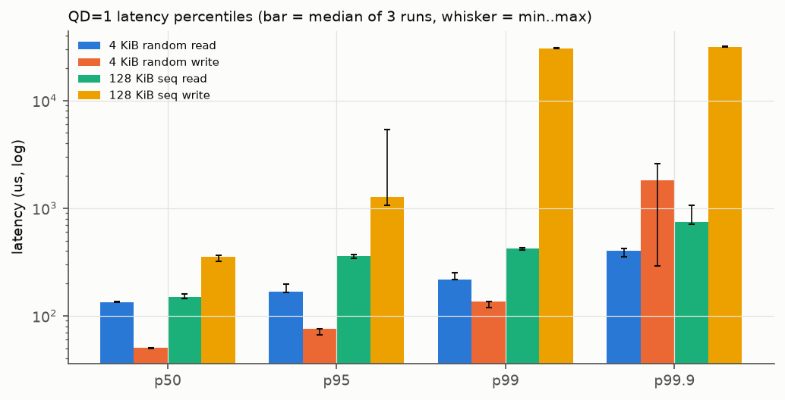
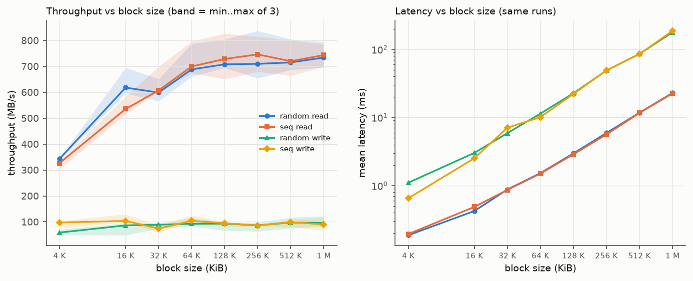
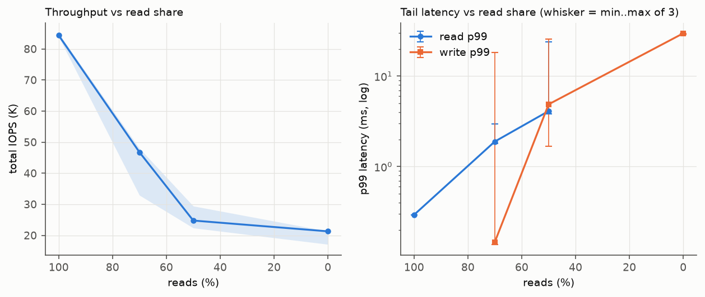
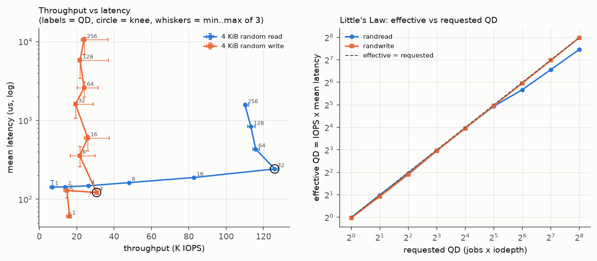
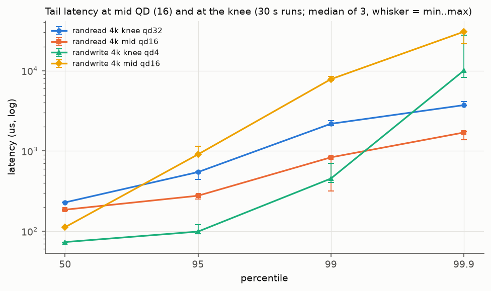
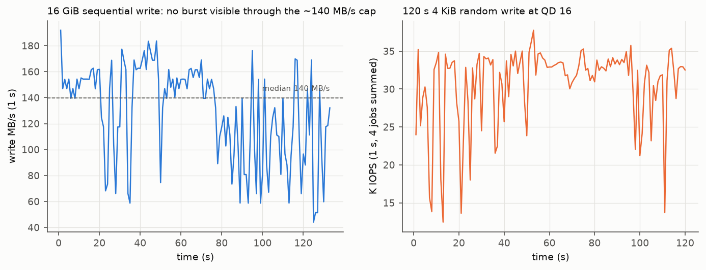
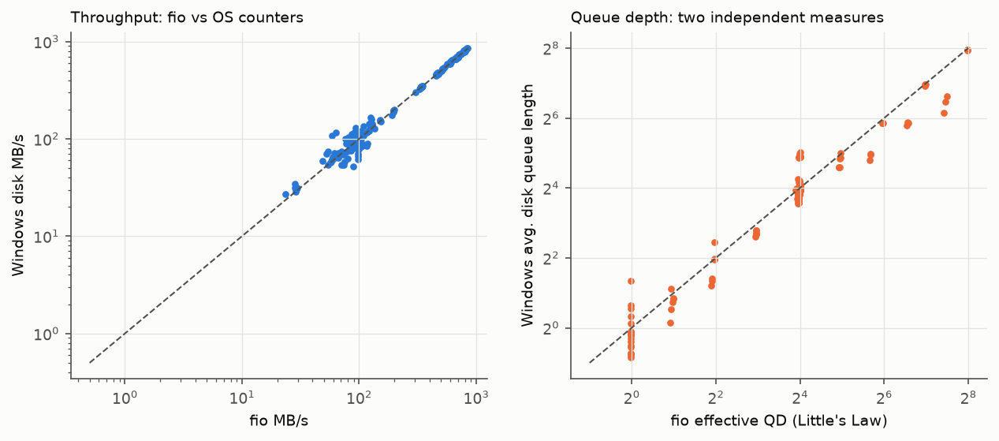
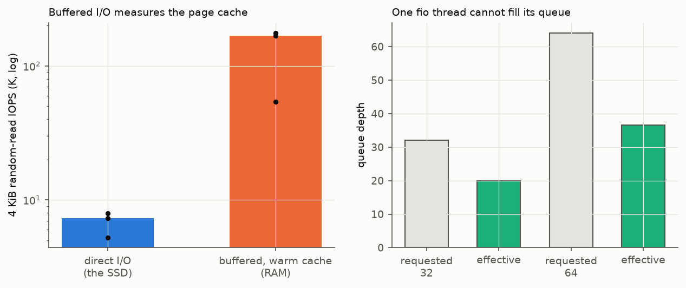

# Project #3: SSD Performance Profiling, Report

ECSE 4320/6320 Advanced Computer Systems. Samsung PM991a 512 GB NVMe SSD (the
laptop's system drive), Windows 11, fio 3.43.

Pre-registered predictions: [HYPOTHESES.md](HYPOTHESES.md), committed before
fio was installed. Safety rules: [SAFETY.md](SAFETY.md). Every number below
comes from [RESULTS_TABLES.md](RESULTS_TABLES.md) (generated by
`scripts/analyze.py`) unless it is marked as coming from
[NOTES.md](NOTES.md), which is also the full record of decisions, bugs and
fixes. The student's review contributions are in
[CONTRIBUTIONS.md](CONTRIBUTIONS.md). AI-use note: [AI-USE.md](AI-USE.md).

**Headline.**
- QD=1 latency: 4 KiB random read 139 us mean (p99 216 us); 4 KiB random
  write 69 us (p99 136 us). Writes are acknowledged from the drive's write
  buffer, reads must reach NAND.
- 4 KiB random read scales almost perfectly up to **QD 32 (126 K IOPS, 242
  us)**, the knee. Past it, latency grows linearly with QD and IOPS stays flat
  (110-116 K). Little's Law holds to within 1-5%, and Windows' own queue
  counter agrees (ratio 0.96).
- The ceilings are far below the drive's specifications: reads **~0.70-0.75
  GB/s** in the sweeps (0.79 GB/s from a cold start, falling to ~0.5-0.6
  GB/s within ~1.5 min of sustained reads), writes **~90-150 MB/s**, at any
  block size. Neither is CPU- or
  encryption-bound (total CPU median 18% for reads, 10% for writes). The
  limit sits on the device/link side, behind a driver that hides the PCIe
  link state. Its cause is not verified.
- Write tails are queueing behind that write cap: p99.9/p50 = 272x at QD 16,
  repeated across runs (195x / 272x / 272x).
- Pitfall: buffered reads from the page cache look 23x faster than the SSD
  (median), and their result swings 3x with OS cache state. One fio thread
  cannot deliver iodepth=64 (effective QD 36.5).

## 1. Methodology, safety and zero-queue baselines (rubric: 30)

| Item | Value |
|---|---|
| SSD | NVMe SAMSUNG MZVLQ512HBLU-00BH1 (PM991a), 512 GB, firmware HPS1NFAV; DRAM-less (uses host memory for its mapping table), TLC NAND with an SLC write cache |
| Interface | PCIe 3.0 x4 per the drive specification, behind Intel RST/VMD (BusType "RAID"). The negotiated link width/speed is **not visible** through the VMD driver |
| Filesystem vs raw | **NTFS file, not raw device.** The drive holds the only usable partition (C:). Tests use disposable files in `C:\fio-test\` with **direct I/O** (`direct=1`), as the assignment allows |
| Capacity / range | 16 GiB main test file (filled once with incompressible data before any read, so reads hit mapped LBAs); a separate 16 GiB file for the device-state write; 256 MiB file for the pitfall. 350 GB of 510 GB free |
| Encryption | BitLocker (Device Encryption) ON, XTS-AES-128 in **software** (the drive has no hardware encryption). Results characterise the full stack: NTFS + BitLocker + RST/VMD + SSD |
| Device settings | write cache enabled; SMART 60 C after the Batch 1 tests, wear 0% (`data/raw/diag_admin.txt`, read-only admin queries) |
| OS / CPU | Windows 11 Home 10.0.26200; Intel Core i3-1125G4, 4 cores / 8 threads, 8 GB DDR4-3200; Balanced scheme, "Best performance", AC power |
| fio | 3.43, `ioengine=windowsaio`, `direct=1`, `thread`, `time_based`, `randrepeat=0`, `norandommap`, `refill_buffers`, `buffer_compress_percentage=0` (incompressible data everywhere, held constant), `lat_percentiles=1` |
| Alignment | every block size is a multiple of 4 KiB, offsets aligned to the block size (fio default), NTFS 4 KiB clusters |
| Durations | reads 8 s + 2 s ramp; writes 5 s + 1 s ramp (wear policy); tail runs 30 s; device-state runs to completion / 120 s |
| Repetitions | **3 repetitions** of every sweep point, repetition loop outermost; median and min..max reported |
| Parallelism | total QD = numjobs x iodepth with numjobs <= 4, because one fio thread is submission-bound at ~55 K IOPS (section 6) |
| Independent check | Windows disk/CPU counters (`typeperf`, 1 s) logged throughout: OS bytes/s / fio MB/s median **1.005** over 172 runs |
| Configs / data | every run's job file in `configs/<sweep>/`, JSON in `data/raw/<sweep>/`, parsed CSV in `data/processed/` |

**Safety** ([SAFETY.md](SAFETY.md)). `scripts/fio_run.py` writes every job
file and refuses, before fio starts:
- raw devices (`\\.\PhysicalDrive*`), bare drive letters, and any path
  outside `C:\fio-test\`;
- buffered I/O, except the read-only pitfall run;
- any run that would leave less than 100 GB free.

fio options that pick files another way (`directory`, `opendir`,
`filename_format`) are refused too. `python scripts/fio_run.py
--selftest-safety` checks that all ten unsafe cases are refused, including
`..` traversal and look-alike folders such as `C:\fio-test-evil\`. Write
volume was kept low on request (system SSD), as summed from fio's io_bytes:
- **113.8 GB** in the full sweeps;
- **~128 GB in total**, including validation, smoke tests and the re-runs.

That is about 0.04% of the drive's rated endurance.

**Zero-queue baselines** (QD=1, median of 3; `plots/qd1_percentiles.png`):

| workload | IOPS | MB/s | mean us | submit us | p50 us | p95 us | p99 us | p99.9 us |
|---|---|---|---|---|---|---|---|---|
| 4 KiB random read | 7170 | 29 | 139 | 10 | 134 | 167 | 216 | 399 |
| 4 KiB random write | 14340 | 59 | 69 | 11 | 50 | 76 | 136 | 1810 |
| 128 KiB seq read | 5566 | 730 | 179 | 16 | 151 | 358 | 424 | 750 |
| 128 KiB seq write | 753 | 99 | 1316 | 39 | 354 | 1270 | 30540 | 31588 |



- **Reads:** the 139 us is a NAND page read (~60-80 us for TLC), a mapping
  lookup (the DRAM-less drive keeps part of its table in host memory), and
  the Windows stack. The submission share alone is 10 us. p99 is only 1.6x
  the median: at QD=1 there is no queueing.
- **Writes are twice as fast as reads at QD=1** (50 us median), because the
  drive acknowledges them from its write buffer (device write cache
  enabled). This proves a buffer, not which buffer: the report does not
  attribute it to the SLC cache (student concern 28).
- **128 KiB sequential write** has a 354 us median but a 30.5 ms p99, even
  at QD=1. A single large write already meets the sustained write cap
  (section 5): most writes are absorbed, and a few wait for the buffer to
  drain.

## 2. Block-size and access-pattern sweeps (rubric: 35)

Fixed: total QD 16 (4 jobs x iodepth 4), 16 GiB range, direct I/O,
incompressible data. Varied: block size 4 KiB - 1 MiB, random vs sequential,
read vs write. Throughput and latency come from the same runs
(`plots/block_size.png`; shaded bands = min..max of 3 runs).

| block | rand read MB/s | seq read MB/s | rand write MB/s | seq write MB/s | rand read IOPS | rand read mean us |
|---|---|---|---|---|---|---|
| 4 KiB | 343 | 327 | 59 | 97 | 83791 | 186 |
| 16 KiB | 618 | 536 | 86 | 104 | 37730 | 422 |
| 64 KiB | 688 | 700 | 93 | 104 | 10504 | 1522 |
| 128 KiB | 708 | 729 | 93 | 95 | 5399 | 2961 |
| 256 KiB | 710 | 746 | 86 | 86 | 2706 | 5908 |
| 1 MiB | 734 | 744 | 96 | 90 | 699 | 22855 |

(32 KiB and 512 KiB in RESULTS_TABLES section 2.)



Interpretation:
- **Two regimes for reads.**
  - Small blocks are **IOPS-bound**: 4 KiB reaches 84 K IOPS at QD 16, so
    the per-command cost (controller, mapping lookup, Windows stack)
    dominates.
  - From 64 KiB on, reads are **bandwidth-bound** at **0.70-0.75 GB/s**:
    IOPS halves with each doubling of size, and latency doubles (2.96 ms at
    128 KiB to 22.9 ms at 1 MiB), as a fixed-bandwidth server predicts
    (latency = QD x size / bandwidth: 16 x 1 MiB / 0.734 GB/s = 22.9 ms).
- **Random and sequential reads converge** above 32 KiB. A large random read
  spans several NAND pages and dies, like sequential access, so the
  controller's internal parallelism hides the pattern. At 4-16 KiB, random is
  equal to or slightly faster than sequential here (no read-ahead advantage
  is visible at QD 16).
- **Writes are flat at ~90-100 MB/s from 16 KiB on**, for both patterns.
  Only 4 KiB random writes are lower (59 MB/s, 14 K IOPS), the per-command
  cost again. Block size cannot raise write throughput: every write pattern
  hits the same sustained cap.
- **The ceilings are an order of magnitude below the drive's class.** The
  PM991a is specified for ~3.1 GB/s reads; PCIe 3.0 x4 allows ~3.5 GB/s.
  Neither the CPU nor encryption explains the gap (student concerns 25 and
  29; NOTES "Investigation"):
  - a read-only scaling test, 1 MiB sequential reads from 1 to 4 threads,
    stayed flat at 618-766 MB/s with 8-14% total CPU;
  - across the sweeps, CPU medians are 18% for reads and 10% for writes;
  - software encryption would scale with threads and saturate a core first.
  The limit is therefore on the device/link side. ~0.75 GB/s usable fits a
  down-trained link (e.g. x1, or a lower PCIe generation) or a power-saving
  state. The VMD driver does not expose the link, so the cause is reported
  as a hypothesis, not a finding.
- **The read ceiling is not fixed; it falls under sustained load**
  ([RECHECK](../../RECHECK_2026-10-22.md); `data/raw/recheck_2026-10-22/`,
  `data/raw/recheck_ceiling/`).
  - Re-run later the same day (same boot, AC power, idle, right after 20 min
    of CPU-heavy sweeps): every 4 KiB result reproduced within 0-3% (QD=1
    read 138.6 us both times; knee again at QD 32, 128.8 K IOPS). Large
    reads, though, were 26-38% slower in every repetition: 128 KiB QD=1 540
    vs 730 MB/s; 1 MiB QD 16 0.45-0.52 GB/s.
  - Targeted read-only follow-up, starting from an idle machine: five
    back-to-back repetitions (1 MiB QD 16, 128 KiB QD=1, 4 KiB QD 32, ~30 s
    per repetition).
    - The first two ran fast: 1 MiB at 793 / 782 MB/s, 128 KiB QD=1 at 721
      MB/s, 4 KiB QD 32 at **147.5 K IOPS**.
    - Within ~1.5 minutes all three fell and stayed down: 563-598 MB/s,
      461-482 MB/s, and 123-126 K IOPS.
  - The same pattern explains why the 30 s tail runs give fewer IOPS than
    the 8 s sweep (section 4a): throughput falls once load is sustained.
    That fits thermal or power-management throttling better than a fixed
    link property.
  - Windows' "PCI Express Link State Power Management" (ASPM) is set to
    **Maximum power savings** even on AC power (`powercfg`, read-only;
    `data/raw/recheck_2026-10-22/powercfg_pcie_aspm.txt`). This is a
    plausible contributor. Testing with ASPM off would change a system
    power setting, so it was not done. Drive temperature during the runs
    was not logged (admin rights needed), so the cause remains unverified.

## 3. Read/write mix and queue-depth analysis (rubric: 40)

### 3a. Read/write mix (fixed: 4 KiB random, QD 16; `plots/rw_mix.png`)

| read/write % | total IOPS | range | read mean us | read p99 us | write mean us | write p99 us |
|---|---|---|---|---|---|---|
| 100/0 | 84366 | 83.9-85.0K | 185 | 293 | - | - |
| 70/30 | 46767 | 32.9-48.0K | 423 | 1892 | 140 | 146 |
| 50/50 | 24769 | 22.4-29.4K | 799 | 4112 | 482 | 4882 |
| 0/100 | 21297 | 17.1-21.3K | - | - | 731 | 29753 |



- **Adding writes costs far more than their share.** 30% writes cut total
  IOPS by 45%, and 50% writes cut it by 71%. The writes are capped at
  ~60-100 MB/s, so once they fill the write path they set the pace, and
  the reads queue behind them.
- **Reads suffer most in the tail.** Read p99 goes from 293 us to 1.9 ms
  (70/30) to 4.1 ms (50/50): a 14x tail increase. NAND reads to a die that is
  busy programming must wait (program/read interference), and buffer flushes
  stall reads. This matches H4.
- **Mixed-workload tails vary strongly between runs**, so the medians above
  hide a wide spread (whiskers in the plot):
  - 70/30 write p99 is 138-146 us in two runs but 18.2 ms in the third;
  - 50/50 read p99 ranges 3.9-24.0 ms.

  The p99.9 is 22-30 ms in every mixed run. Whether p99 lands below or
  inside that stall regime depends on how often the write buffer drains
  during the 8 s run. Tail percentiles of mixed workloads therefore need
  longer runs than throughput does.
- The mix's pure-read point (84 K) equals the QD sweep at the same QD 16
  (82.5-83.0 K); the 126 K peak is at QD 32 (student concern 30).

### 3b. Queue depth: throughput-latency curve, knee and Little's Law

Fixed: 4 KiB random, 16 GiB range. Varied: total QD 1-256 as (jobs,
iodepth) pairs up to 4 jobs (`plots/qd_knee.png`).

| requested QD | effective QD | randread IOPS | mean us | p99 us | randwrite IOPS | randwrite mean us |
|---|---|---|---|---|---|---|
| 1 | 1.0 | 6937 | 143 | 226 | 16191 | 61 |
| 4 | 3.9 | 26307 | 148 | 210 | 30624 | 122 |
| 8 | 7.8 | 48013 | 163 | 239 | 21563 | 358 |
| 16 | 15.6 | 82715 | 189 | 297 | 25914 | 598 |
| **32 (knee)** | 30.5 | **125985** | 242 | 457 | 19348 | 1605 |
| 64 | 51.0 | 115831 | 433 | 3064 | 23970 | 2597 |
| 128 | 94.5 | 113210 | 835 | 8225 | 21763 | 5776 |
| 256 | 176.1 | 110070 | 1571 | 18481 | 23920 | 10544 |

(Effective QD shown for random reads; the full table, with QD 2 and all
ranges, is RESULTS_TABLES section 4.)



- **Knee at QD 32**, by a rule fixed before the analysis: the smallest QD
  reaching >= 90% of the best IOPS. Up to QD 32 the curve is almost ideal:
  IOPS grows 18x for 32x QD while mean latency grows only 1.7x (143 to 242
  us). Beyond it, IOPS stays flat (110-116 K) and latency grows in
  proportion to QD (433 us to 1.57 ms). p99 jumps 6.7x from QD 32 to 64.
  The controller's parallelism (dies x planes in flight) is exhausted, and
  extra commands only wait in a queue.
- **Little's Law, L = lambda x W.** Effective QD = IOPS x mean latency equals
  the requested QD to within 1-5% up to QD 32. That confirms the
  measurement: every outstanding command is accounted for.
  - Above 32 the effective QD falls short (51, 95, 176 for 64, 128, 256).
    Each thread's submission cost (~10-20 us) limits how many commands it can
    keep outstanding. The knee is still real: with 51 commands in flight,
    IOPS did not rise.
  - Windows' independent "Avg. Disk Queue Length" agrees with fio's
    effective QD (median ratio 0.96, RESULTS_TABLES section 8).
- **Peak versus ceiling.** 126 K x 4 KiB = 0.52 GB/s, below the 0.75 GB/s
  read ceiling, so the 4 KiB knee is set by command throughput, not
  bandwidth.
- **Random writes have no knee worth the name.** They sit at 15-31 K IOPS
  (60-125 MB/s, the write cap) at every QD, and mean latency grows linearly
  with QD: 61 us at QD 1 to 10.5 ms at QD 256. Little's Law is exact (31.1 at
  QD 32, 253 at QD 256). The 90% rule gives "QD 4", but the curve is flat;
  queue depth buys only latency. The write runs are noisy (e.g. QD 16 range
  24-37 K) because 5 s runs see buffer drain at different phases.

## 4. Tail latency and device state (rubric: 25)

### 4a. Tail latency (30 s runs; `plots/tail_latency.png`)

| run | IOPS | p50 us | p95 us | p99 us | p99.9 us | p99.9 / p50 |
|---|---|---|---|---|---|---|
| randread QD 16 (mid) | 73848 | 185 | 276 | 831 | 1696 | 9 |
| randread QD 32 (knee) | 101731 | 228 | 545 | 2179 | 3719 | 16 |
| randwrite QD 4 (rule knee) | 33038 | 73 | 99 | 453 | 10027 | 137 |
| randwrite QD 16 (mid) | 31771 | 112 | 905 | 7832 | 30540 | 272 |



- **Reads: the tail grows at the knee.** p99.9/p50 rises from 9x (QD 16) to
  16x (QD 32), and the ratios repeat across runs (8-9x, 16-18x). At the knee
  the device is near saturation, so any internal hiccup (a read behind a
  program or erase, a mapping-table miss to host memory) lets a queue build
  up. Queueing theory predicts this: waiting-time variance grows as
  utilisation approaches 1, so tails grow faster than means.
- **Writes: tails are queueing behind the write cap.** At QD 16 the median
  write is fast (112 us, absorbed by the buffer), but p99.9 is 30.5 ms
  (272x). The ratio repeats across runs: 195x / 272x / 272x (concern 31).
  Little's Law fixes the mean at 16 / 31.8 K IOPS = 0.5 ms. A 30.5 ms
  p99.9 therefore means occasional stalls of tens of ms: the buffer stops
  accepting, and every queued write waits for NAND programming and garbage
  collection to free space. For large writes the queueing shows even in the
  median: 16 x 128 KiB / ~150 MB/s = ~14 ms, against a measured p50 of
  13-35 ms (NOTES, Batch 1).
- These 30 s runs give lower IOPS than the 8 s QD sweep (102 K vs 126 K at
  QD 32; 74 K vs 83 K at QD 16). Sustained load costs throughput, possibly
  through heat or background work; temperature was not logged during runs,
  so this is not attributed.

### 4b. Device state: burst vs steady state (`plots/device_state.png`)



- **16 GiB sequential write** (1 MiB, QD 8, fresh file, 1 s samples):
  192 MB/s in the first second, median 140, minimum 44 MB/s over 133 s.
  - The predicted SLC burst (~1.8 GB/s for tens of GB, H7) is **not
    observable**: the ~140 MB/s cap applies from the first second, and it
    would hide any faster SLC phase. The data do not show whether the SLC
    cache works (student concern 32).
  - A regime change is visible: ~140-180 MB/s for the first ~75 s (~10 GB),
    then repeated stalls down to 45-60 MB/s. This fits an internal buffer
    filling, or heat building up. Without in-run temperature the two cannot
    be separated.
- **120 s 4 KiB random write** at QD 16: first 10 s 26.7 K IOPS, last 10 s
  30.8 K IOPS (min 12.5 K, max 37.8 K). No decline within 120 s: at ~125 MB/s
  the run writes only ~15 GB, so the drive never reaches the
  write-amplified steady state that a full-drive precondition would produce.
  That was deliberate (wear policy on a system SSD), and it is a limitation.
- **Working set / LBA range.** Direct 4 KiB QD=1 random reads on a 256 MiB
  file (pitfall runs) gave 7.3 K IOPS / 136 us (median), versus 7.2 K / 139
  us on the 16 GiB file. On this drive, an LBA range 64x wider does not cost
  measurable latency, so its mapping-table caching covers 16 GiB. The two
  were measured in different sessions; a dedicated LBA-range sweep was not
  run.
- **Thermal.** SMART read 60 C right after the Batch 1 tests (warm but
  below typical throttle points of ~70-80 C). In-run temperature needs admin
  rights and was not logged, so throttling is neither confirmed nor ruled
  out.

## 5. Reproducibility and data hygiene (rubric: 25)

Reproduce from Git Bash in this folder (fio 3.43 and Python 3 with
matplotlib):

```bash
scripts/capture_env.sh > data/raw/env.txt        # OS, CPU, SSD, partitions, power, tools
python scripts/fio_run.py --selftest-safety       # all 10 unsafe cases must be refused
python -u scripts/run_sweeps.py all               # ~45 min, machine idle; QUICK=1 for a short smoke run
python scripts/parse_fio.py                       # data/raw/<sweep>/*.json -> data/processed/<sweep>.csv
python scripts/analyze.py                         # plots/, summary CSVs, reports/RESULTS_TABLES.md
scripts/diag_admin.sh                             # ADMIN, optional: write cache, BitLocker, SMART
```

- **Configs:** every run's exact job file is in `configs/<sweep>/<name>.fio`.
- **Raw data:** fio JSON with a `_meta` block (sweep, repetition, start/end
  time, full parameters) in `data/raw/<sweep>/`; bandwidth/IOPS logs in
  `data/raw/state/`; Windows counters in `data/raw/perf_log*.csv`; the run
  log in `data/raw/sweep_run.log`.
- **Failed runs are never parsed:** they are renamed `*.json.failed`, and the
  parser stops on any invalid JSON with the file's name. The full sweep had
  205 runs and 0 failures.
- **Repetition:** 3 repetitions, repetition loop outermost, so slow drift
  shows up as spread rather than bias; tables give median and min..max.
- **Kept, not deleted:** runs set aside for good reasons stay in the
  repository, labelled: `data/raw/pitfall_run1/` (interference / cache
  eviction), `investigate/` and `validation/` (Batch 1 checks).
- **Environment:** `data/raw/env.txt`, `env_notes.txt` (manual facts) and
  `diag_admin.txt` (write cache, encryption, SMART).
- **Cross-check:** two independent tools agree. Windows bytes/s vs fio
  matches at a median ratio of 1.005 (172 runs), and queue length at 0.96
  (`plots/os_crosscheck.png`).



## 6. Misleading setups and AI use (rubric: 15)



**Pitfall 1: buffered I/O measures the page cache, not the SSD.** The
comparison is like for like: the same 256 MiB file, 4 KiB random reads,
QD 1, three repetitions.
- Direct I/O: 5.3-8.0 K IOPS, 125-189 us.
- Buffered (psync, after one warming read with `invalidate=0`): 54-177 K
  IOPS, 5-18 us.
- The median gap is **23x**. The warming pass itself "read" at 4.7-5.1
  GB/s, 6x above anything this SSD delivers: the data came from RAM.

The trap has two layers:
- fio invalidates the cache before each job by default, so a naive buffered
  test can look correct once and wrong the next time. Our first run's third
  repetition read from disk and missed the cache (2.5 K IOPS, slower than
  direct).
- Buffered results swung 3x between repetitions with OS cache state, while
  direct I/O stayed steady.

Student concern 27 made the comparison fair. With the same engine, cold vs
warm cache gave 10.7 K vs 189 K IOPS, so the cache is the cause, not the
I/O engine.

**Pitfall 2: requested iodepth is not the effective queue depth.** One fio
thread with iodepth 32 or 64 delivers ~54.5 K IOPS, with an effective QD
(Little's Law) of only 19.9 and 36.5. Submission costs ~17-21 us per command
on Windows, which caps a thread at ~55 K IOPS. The same total QD 32 spread
over 4 jobs gives 126 K IOPS. A one-thread QD sweep would have placed the
"knee" at a submission limit of the host, not of the SSD. Hence the 4-job
design, and an effective-QD column in every table.

**AI use:** see [AI-USE.md](AI-USE.md). Every AI claim here was checked
against data. The student's challenges led to the claims that were
retracted or reworded (CONTRIBUTIONS 25-32), most importantly the
retraction of "BitLocker is the bottleneck".

## 7. Hypotheses scorecard (from [HYPOTHESES.md](HYPOTHESES.md))

| # | Prediction | Measured | Verdict |
|---|---|---|---|
| H1 | QD=1 4K read 90-130 us; 4K write 20-40 us, faster than reads; 128K seq read 100-200 us; 128K seq write 80-150 us | 139 us; 69 us (p50 50), writes 2x faster than reads; 179 us; 1316 us mean / 354 us p50 | Mostly right in shape (writes faster), slightly slow on reads, wrong on 128K writes (the write cap) |
| H2 | 200-350 K random read IOPS; ~3.0 GB/s seq read; ~1.8 GB/s seq write | 126 K; 0.73-0.75 GB/s; ~0.1-0.15 GB/s | **Wrong:** device/link-side ceilings far below spec (cause unverified) |
| H3 | IOPS falls and MB/s rises with block size, saturating at 128-256 KiB; latency proportional to size once bandwidth-bound | Saturation from 64 KiB (reads), 16 KiB (writes); latency exactly proportional | Right, saturating earlier because the ceilings are low |
| H4 | Mixes below pure; 70/30 > 50/50; reads see higher tails in mixes | 84 K / 47 K / 25 K; read p99 0.29 -> 1.9 -> 4.1 ms | Right: total IOPS falls steadily with the write share (writes set the pace), staying between pure read and pure write |
| H5 | Knee ~QD 16-32; flat latency before, linear after; Little's Law within ~10% | Knee QD 32; latency x1.7 up to 32, then linear; Little's Law within 1-5% | **Right** |
| H6 | p99.9 5-10x p50 near the knee; writes largest tails | Reads 9x (mid), 16x (knee); writes 137-272x | Direction right, magnitudes larger (queueing behind the write cap) |
| H7 | SLC burst ~1.8 GB/s for tens of GB, then drop; steady-state random writes worse; possible throttling | No burst observable through a ~140 MB/s cap; stalls after ~10 GB; no decline in 120 s random writes | Not testable as stated: the cap hides the burst. The regime change is consistent with buffer exhaustion or heat |
| H8 | Buffered reads show impossibly high IOPS and single-digit us | 177 K IOPS at 5.4 us vs 8.0 K direct; warm pass at 5 GB/s (> drive) | Right in kind (not > 1 M IOPS at QD 1 psync); the effective-QD pitfall appeared through thread submission limits |

Pre-registered falsifiers: the QD=1 read stayed inside 50-300 us; no direct
measurement exceeded the interface ceiling; a knee exists; Little's Law held
within 5%. "No write drop after tens of GB" did occur, but because of the
write cap: the drop it looks for cannot be seen through the cap.

## 8. Limitations
- **System drive, file-level testing.** A raw device was not safe to use.
  Every number includes NTFS, BitLocker software encryption and the Intel
  RST/VMD driver, and may not match the PM991a measured raw on another host.
- **The ceilings are unexplained, and the read ceiling depends on load
  history.** It ranges from 0.79 GB/s from a cold start down to ~0.5 GB/s
  after sustained load, so the block-size throughput numbers describe the
  sweep's own conditions. The 0.75 GB/s read and ~0.15 GB/s write ceilings
  are not CPU-bound, but the PCIe link state is invisible behind
  VMD. A down-trained link, an aggressive power state, the driver path, or
  thermal state could each explain them. Verifying this would need firmware
  or BIOS access (e.g. disabling VMD), which is out of scope on a personal
  laptop.
- **No in-run temperature.** SMART needs admin rights and was read once (60
  C). Thermal throttling is neither confirmed nor excluded for the
  device-state stalls or the lower 30 s throughput.
- **Wear-limited write tests.** 5 s write runs, a 16 GiB burst test and 120 s
  of random writes keep sweep writes to 113.8 GB (~128 GB including
  validation, smoke tests and re-runs). Full preconditioning to a
  steady state (writing the whole drive several times) was deliberately not
  done, so "steady state" here means a sustained 120 s load, not a
  fully-aged drive. The short write runs are noisier.
- **Single-session runs** on a laptop with background OS activity. Spread is
  reported, and the Windows counters agree with fio. Pitfall run 1 was
  degraded by activity during the run and is archived, not used.
- **Only incompressible data** (held constant). A compressible-data
  comparison was not run; the PM991a is not known to compress, so little
  effect is expected, but that is unverified.
- **No dedicated LBA-range sweep;** the 256 MiB vs 16 GiB comparison comes
  from different sessions.
- **The effective QD above 64 is below the request** (176 at 256) because of
  submission cost with 4 jobs. The plateau beyond the knee is still clear,
  but QD 256 was not fully delivered.
